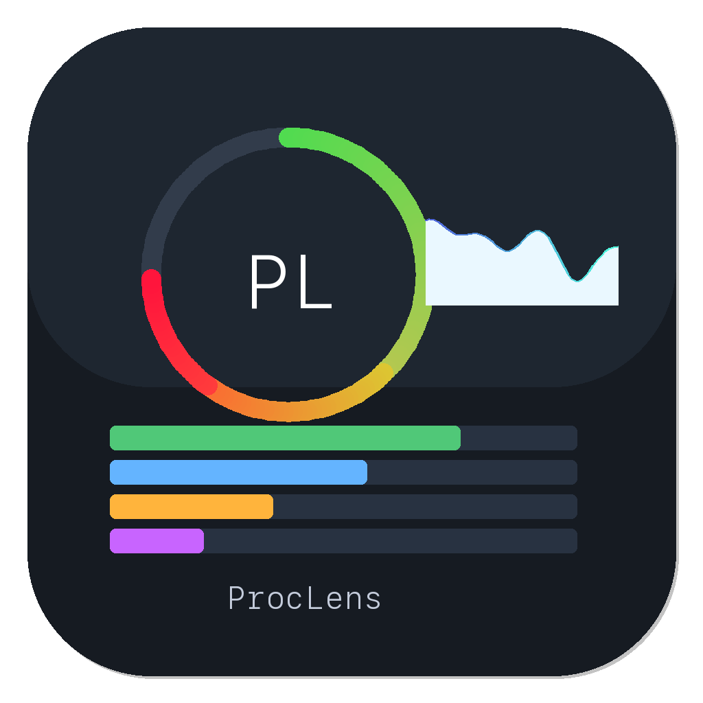

<p align="center">
  
</p>

<h1 align="center">ProcLens</h1>

<p align="center">
  <strong>A native macOS process monitor</strong> — inspired by Process Hacker
</p>

<p align="center">
  
  
  
  
</p>

---

ProcLens watches every process on your Mac in real time: CPU and memory history, network throughput, disk I/O, open files, loaded modules, code signature, and more — in a single fast, native window. View, search, sort, suspend, kill, and inspect any process without touching Terminal.

## Features

| Feature | Description |
|---------|-------------|
| **Process List & Tree** | PID, Name, CPU %, Memory, Received, Sent, User, Threads, Status, Ports, Arch, Disk Read, Disk Write, Uptime, Signature, and PPID — sortable, and shared between the flat List and hierarchical Tree views |
| **Customizable Columns** | Right-click any column header for a native show/hide menu, drag a header to reorder it, or drag a divider to resize it — order and visibility are remembered per view |
| **Sparkline Graphs** | Real-time CPU history per process, inline in the table and in the inspector |
| **Process Tree** | Parent/child hierarchy rooted at `launchd`. Click a header to sort siblings; click again to reverse. Click a disclosure arrow to expand a branch |
| **Subprocesses** | Double-click a process, or right-click → **Show Subprocesses**, to open its children in a resizable window |
| **Inspector Panel** | **Info** (status, architecture, code signature, team ID, launch origin, priority), **Modules** (loaded frameworks via `vmmap`, with click-to-copy full paths), **Network**, **Files**, and **Env** tabs for the selected process |
| **Network Connections** | Per-process TCP/UDP connections and listening ports |
| **Network Activity** | A dedicated view sorted by throughput, with live received/sent rates for every process macOS reports |
| **Open Files** | Every file descriptor held by a process, with a search filter |
| **Environment Variables** | Full environment dump per process, with search |
| **Process Context Menu** | Right-click any process to show its subprocesses, copy PID/name/path, reveal it in Finder, suspend/resume, terminate, or force kill |
| **Suspend / Resume** | SIGSTOP / SIGCONT from the toolbar or the right-click menu |
| **Kill Process** | SIGTERM or SIGKILL, with a confirmation dialog |
| **Priority Control** | Adjust a process's nice value with a slider |
| **Export CSV** | Export the full process list for offline analysis |
| **Dark / Light Theme** | System, Light, or Dark, switchable from the menu bar |
| **Real App Icons** | Shows the actual app bundle icon for apps and their bundled helper executables |
| **Search** | Filter processes by name, PID, user, or path |

## Network usage

- In **List** and **Tree**, **Received** and **Sent** show cumulative bytes per process. Click a column header to sort.
- Open **Network** and look at **Received/s** and **Sent/s** for live transfer speeds. The graphs below the table show combined rates for every process macOS reports through `nettop`.
- A dash means no data is available yet. Rates appear after two samples; a zero rate means the counter didn't increase during the sampling interval.
- Select a process and open the **Network** inspector tab to see its individual TCP and UDP connections.

## Install

### Download

Grab the latest DMG from [Releases](https://github.com/NonBytes/ProcLens/releases/latest), open it, and drag **ProcLens** into **Applications**.

New builds target Apple Silicon only. [ProcLens v1.0.2](https://github.com/NonBytes/ProcLens/releases/tag/v1.0.2) is the last release with an Intel binary. The DMG contains an ad-hoc signed app without Apple notarization — on first launch, right-click the app and choose **Open** to bypass Gatekeeper.

### Build from source

Requires Xcode 16 or later.

```bash
git clone https://github.com/NonBytes/ProcLens.git
cd ProcLens
open ProcLens.xcodeproj
```

Build and run with `⌘R`. Use [XcodeGen](https://github.com/yonaskolb/XcodeGen) to regenerate `ProcLens.xcodeproj` after editing `project.yml`. Pushing a `vX.Y.Z` tag triggers the GitHub Actions workflow that builds and publishes the Apple Silicon DMG.

## Keyboard Shortcuts

| Shortcut | Action |
|----------|--------|
| `⌘R` | Refresh process list |
| `⌘E` | Export to CSV |

## Requirements

- macOS 14.4 (Sonoma) or later
- Apple Silicon Mac — Intel Macs can use [v1.0.2](https://github.com/NonBytes/ProcLens/releases/tag/v1.0.2)

## Architecture

```
ProcLens/
├── App/              # App entry point, settings, theme
├── Models/           # ProcessItem, ProcessColumn, DetailModels (network, files, tree)
├── Services/         # ProcessManager, SystemMonitor, HistoryTracker,
│                     # NetworkSampler, ProcessDetails, IconProvider
├── Views/            # ContentView, ProcessListView, ProcessTreeView,
│                     # ProcessDetailView, SystemStatsView, SparklineView,
│                     # NetworkActivityView, DetailTabsView
├── Bridge/           # C bridging for disk I/O
└── Assets.xcassets/  # App icon
```

## Tech Stack

- **SwiftUI** + **@Observable** (macOS 14 Observation framework), with native `Table` + `TableColumnCustomization` for the process views
- **Darwin APIs** — `sysctl`, `proc_pidinfo`, `proc_listallpids`, `host_processor_info`
- **lsof** — network connections and open files (on-demand)
- **nettop** — per-process network byte counters
- **vmmap** — loaded modules for the Modules inspector tab
- **KERN_PROCARGS2** — environment variable extraction

## License

MIT
