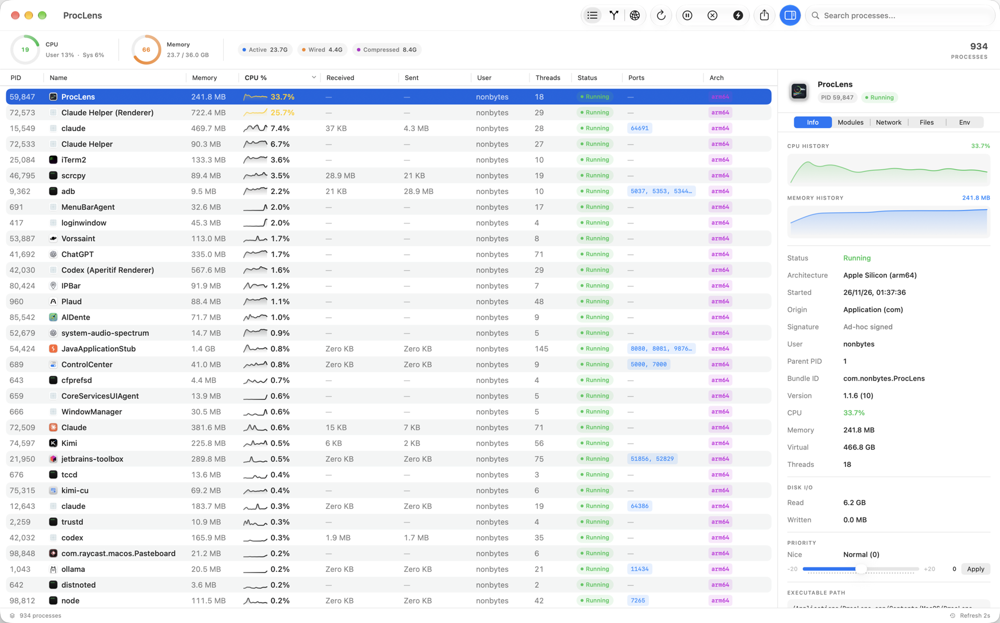
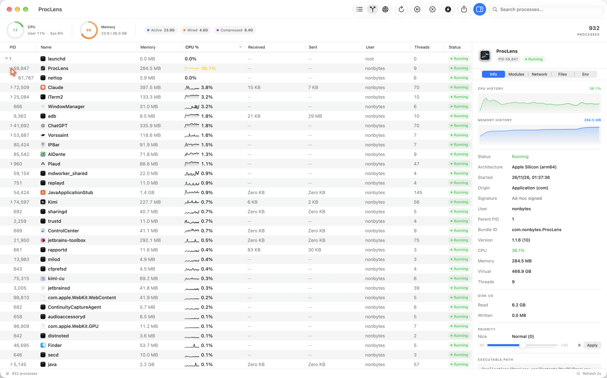
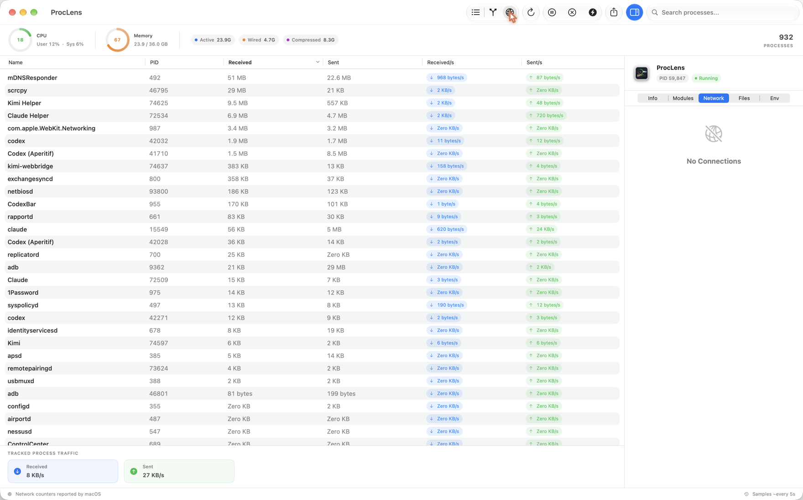

<p align="center">
  
</p>

<h1 align="center">ProcLens</h1>

<p align="center">
  <strong>macOS Process Monitor</strong> — inspired by Process Hacker
</p>

<p align="center">
  
  
  
  
</p>

<p align="center">
  
</p>

---

Native SwiftUI app for real-time process monitoring on macOS. View, search, sort, suspend, kill, and inspect every process running on your Mac.

## Screenshots

<p align="center">
  
</p>
<p align="center"><em>Process Tree View: Hierarchical parent-child relationship with full column sorting</em></p>

<br>

<p align="center">
  
</p>
<p align="center"><em>Network Activity: Real-time throughput rates, bandwidth sparklines, and socket metrics</em></p>

## Features

| Feature | Description |
|---------|-------------|
| **Process List** | Sortable columns · PID, Name, CPU %, Memory, Received, Sent, User, Threads, Status, Ports, Arch, Disk Read, Disk Write, Uptime, Signature, PPID |
| **Customizable Columns** | Right-click any column header to show or hide columns, drag a header to reorder it, or drag a divider to resize it |
| **Sparkline Graphs** | Real-time CPU history per process, inline in the table |
| **Process Tree** | Same customizable columns as List, in a hierarchical parent-child view. Click a header to sort siblings and click again to reverse the order. Click the disclosure arrow next to `launchd` (PID 1) to expand it |
| **Subprocesses** | Double-click a process in List or Tree, or right-click and choose **Show Subprocesses**, to open a resizable window |
| **Inspector Panel** | Info (Signature, Entitlements, Launch Origin), Modules (`vmmap`), Network, Files, and Env tabs load for the selected process |
| **Network Connections** | Per-process TCP/UDP connections and listening ports |
| **Network Activity** | Sort processes by bytes received or sent and view live transfer rates for processes reported by macOS |
| **Open Files** | All file descriptors with search filter |
| **Environment Variables** | Full env dump per process with search |
| **Process Context Menu** | Right-click a live process in List, Tree, or Network to show subprocesses, copy PID/name/path, reveal its executable in Finder, suspend/resume, terminate, or force kill |
| **Suspend / Resume** | SIGSTOP / SIGCONT from toolbar or right-click menu |
| **Kill Process** | SIGTERM or SIGKILL with confirmation dialog |
| **Priority Control** | Adjust nice value with a slider |
| **Export CSV** | Export full process list to CSV |
| **Dark / Light Theme** | System, Light, or Dark — switchable from menu bar |
| **Real App Icons** | Displays the app bundle icon for apps and their bundled executables |
| **Search** | Filter processes by name, PID, user, or path |

## Network usage

- In **List** and **Tree**, **Received** and **Sent** show cumulative bytes per process. Click a column header to sort.
- Open **Network** and look at **Received/s** and **Sent/s** for transfer speeds. The graphs below show combined rates for the processes that macOS reports through `nettop`.
- A dash indicates missing data. Rates appear after two samples. A zero rate means the counter did not increase during the measured interval.
- Select a process and open **Network** in the Inspector to see its TCP and UDP connections.

## Install

### Download

Grab the latest DMG from [Releases](https://github.com/NonBytes/ProcLens/releases/latest), open it, and drag **ProcLens** to **Applications**.

New builds target Apple Silicon. [ProcLens v1.0.2](https://github.com/NonBytes/ProcLens/releases/tag/v1.0.2) is the last release for Intel Macs and includes both Intel and Apple Silicon binaries. The DMG contains an ad hoc signed app without Apple notarization.

### Build from source

Requires Xcode 16 or later. Open the checked-in Xcode project and build and run with `⌘R`.

```bash
git clone https://github.com/NonBytes/ProcLens.git
cd ProcLens
open ProcLens.xcodeproj
```

Use [XcodeGen](https://github.com/yonaskolb/XcodeGen) to regenerate the project when editing `project.yml`. Pushing a new version tag triggers the GitHub Actions workflow that builds and publishes the Apple Silicon DMG.

## Keyboard Shortcuts

| Shortcut | Action |
|----------|--------|
| `⌘R` | Refresh process list |
| `⌘E` | Export to CSV |

## Requirements

- macOS 14.4 (Sonoma) or later
- Apple Silicon Mac. Intel Macs can use v1.0.2.

## Architecture

```
ProcLens/
├── App/              # App entry point, settings, theme
├── Models/           # ProcessItem, ProcessColumn, DetailModels (network, files, tree)
├── Services/         # ProcessManager, SystemMonitor, HistoryTracker,
│                     # NetworkSampler, ProcessDetails, IconProvider
├── Views/            # ContentView, ProcessListView, ProcessTreeView,
│                     # ProcessDetailView, SystemStatsView, SparklineView,
│                     # NetworkActivityView, DetailTabsView
├── Bridge/           # C bridging for disk I/O
└── Assets.xcassets/  # App icon
```

## Tech Stack

- **SwiftUI** + **@Observable** (macOS 14 Observation framework)
- **Darwin APIs** — `sysctl`, `proc_pidinfo`, `proc_listallpids`, `host_processor_info`
- **lsof** — network connections and open files (on-demand)
- **nettop** — per-process network byte counters
- **KERN_PROCARGS2** — environment variable extraction

## License

MIT
